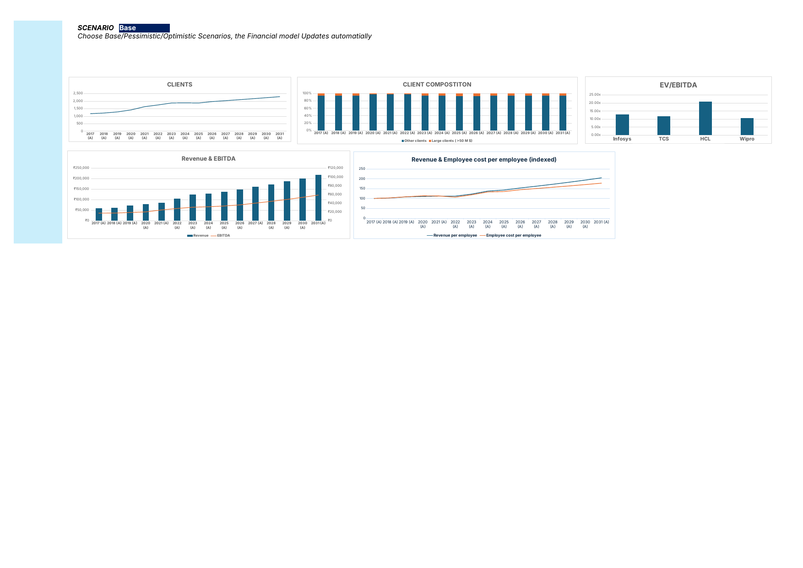
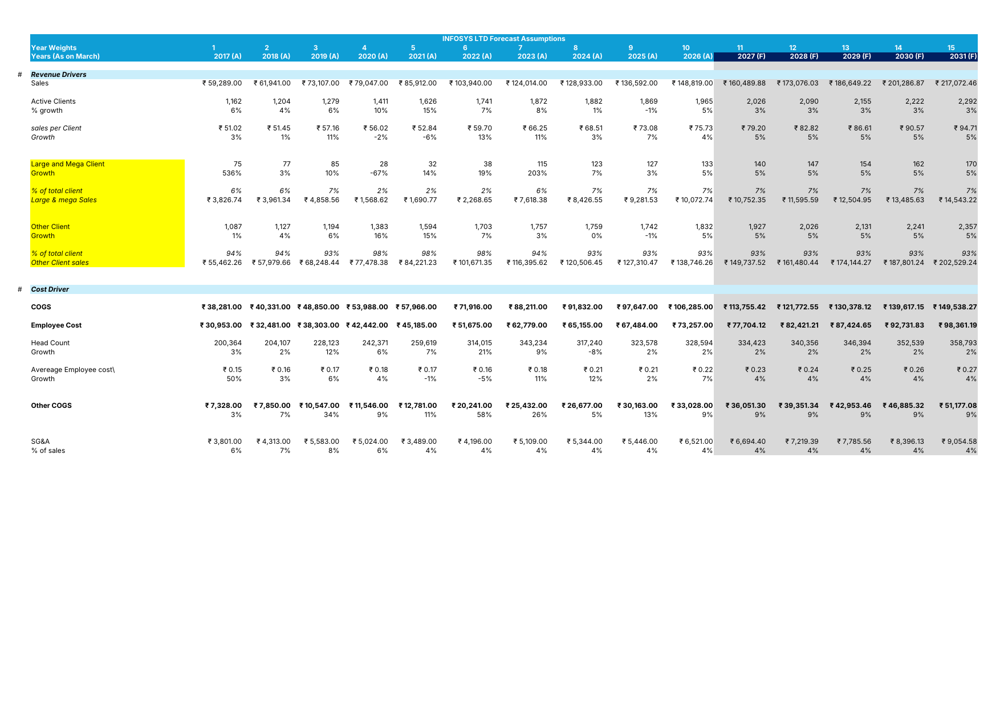
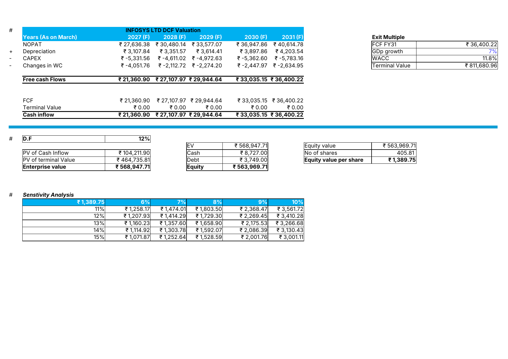

# Infosys (NSE: INFY) — 3-Statement Model, DCF Valuation & Scenario Analysis

A KPI-driven financial model for Infosys Ltd., built off disclosed operational
metrics (Active Clients, Headcount, Utilization, Attrition) rather than
top-down revenue growth assumptions. Covers FY17–FY26 actuals and a FY27–FY31
forecast, with a fully reconciled 3-statement build and a DCF valuation.

## Model structure

**Revenue driver chain:** Active Clients × Sales per Client — not a flat
growth assumption. Both lines are historically derived and trended forward.

**Cost driver chain:** Head Count × Average Employee Cost per Employee, which
rolls up into COGS alongside Other COGS and SG&A (each modeled as % of
sales, trailing-average based).

**Scenario toggle:** a single dropdown (Pessimistic / Base / Optimistic)
drives GDP growth, Headcount growth, Average Employee Cost growth, Active
Client growth, Sales-per-Client growth, and the Large/Other client split
simultaneously via `INDEX/MATCH`, cascading through the full 3-statement
model and DCF output.

**Balance Sheet:** reconciles exactly (Assets = Liabilities + Equity) across
all five forecast years — verified via a built-in Check row.

**DCF Valuation:**
- WACC: 11.8%, using market-cap-weighted equity (not book value)
- Cost of equity via CAPM, with Beta (0.97) derived from an actual
  regression of 5 years of daily Infosys vs. Nifty 50 returns — not assumed
- Terminal Value via Gordon Growth, discounted back the full 5-year horizon
- Two-way sensitivity table: WACC vs. terminal growth rate
- EV/EBITDA comparison against TCS, HCL Technologies, and Wipro

**Output:** DCF-implied value of ₹1,389.75/share (Base case)

## Screenshots

**Dashboard** — scenario toggle, client trends, Revenue/EBITDA, peer
EV/EBITDA, and indexed Revenue-per-Employee vs. Employee-Cost-per-Employee

**Forecast Drivers** — revenue and cost driver build, FY17 actuals through
FY31 forecast

**DCF Valuation** — FCF build, WACC, terminal value, and sensitivity table

## Tools

Excel (fully formula-driven, no hardcoded forecast outputs) · Python/openpyxl
used in the build/QA process · NSE, Screener.in, and company filings as data
sources

## Notes

This is an independent academic/portfolio exercise, not investment advice.
Built as part of a broader portfolio of Indian-equity financial models
(IndiGo, Britannia Industries, others) undertaken alongside CMA (US)
coursework.
